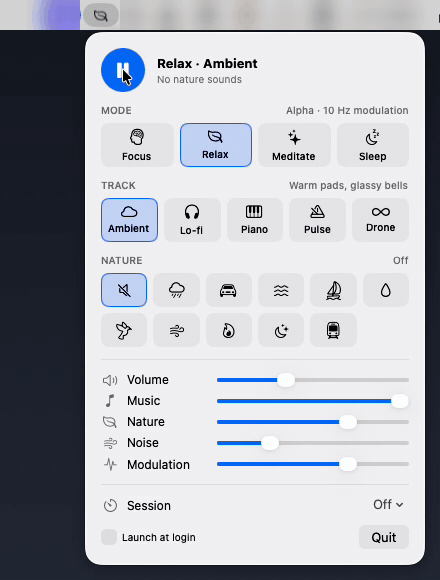

# Hum

A macOS menu-bar app that generates endless focus, relax and sleep music in real time. It modulates the music at brainwave-band rates, the technique behind Brain.fm, and every sound is synthesized live: no recordings, no streaming, no account.



([MP4 version with sound](docs/menu-demo.mp4). The soundtrack was rendered by Hum's engine replaying the same clicks, not captured live.)

## Why

Apps like Brain.fm make music for focus and sleep using *amplitude modulation*: the volume pulses quickly and steadily, which is meant to nudge brain activity toward a target rhythm. Brain.fm's peer-reviewed study (Woods et al., *Communications Biology*, 2024) found that music with ~16 Hz modulation helped some people sustain attention, especially people with ADHD symptoms.

Hum is a free, open, offline take on that idea:

- **It never repeats.** A generative composer writes the music as it plays: chord progressions, melodies, drums and textures.
- **It runs locally.** No subscription, no streaming, no network access. It uses about 2–9% of one CPU core.
- **It's tunable.** You choose how strong the modulation is, from none at all to deep.

A caveat: only the 16 Hz Focus setting is close to what has been studied. The Relax, Meditate and Sleep rates extend the same idea to other brainwave bands, and Hum's own sounds have not been tested in any study. Treat it as pleasant background music, not a medical tool.

## Listen

Each clip is 30 seconds, rendered by Hum's engine:

- [Focus · Lo-fi · Rainy Street](docs/audio/focus-lofi-rainy-street.m4a)
- [Focus · Pulse](docs/audio/focus-pulse.m4a)
- [Relax · Piano · Seaside](docs/audio/relax-piano-seaside.m4a)
- [Meditate · Ambient · Old Train](docs/audio/meditate-ambient-old-train.m4a)
- [Sleep · Drone · Fireplace](docs/audio/sleep-drone-fireplace.m4a)

## What's inside

**Modes** set the modulation rate, key and tempo:

| Mode     | Modulation      | Music                                   |
|----------|-----------------|-----------------------------------------|
| Focus    | 16 Hz (beta)    | D dorian, brighter, more notes          |
| Relax    | 10 Hz (alpha)   | F lydian, slower                        |
| Meditate | 6 Hz (theta)    | C mixolydian, spacious                  |
| Sleep    | 2 Hz (delta)    | A aeolian, dark                         |

**Tracks** set the style:

| Track   | Sound                                                                          |
|---------|--------------------------------------------------------------------------------|
| Ambient | Warm detuned pads, glassy bell melodies                                        |
| Lo-fi   | Rhodes-style electric piano, swung hip-hop drums, plucked bass, vinyl crackle, tape warble |
| Piano   | Sparse broken-chord piano over a soft pad                                      |
| Pulse   | 16th-note arpeggios, four-on-the-floor kick, pads ducking on each kick         |
| Drone   | Slow, deep and beatless                                                        |

**Nature scenes** play underneath the music and are never modulated: Rain, Rainy Street (cars hissing past with a Doppler shift), Ocean Surf, Seaside (lapping waves and gulls), Stream, Forest (birdsong), Wind, Fireplace, Night (crickets) and Old Train (rail-joint clickety-clack, rumble and a distant whistle).

**Controls:** volume; separate music, nature and noise levels; modulation strength; a session timer (25, 50, 90 or 120 minutes, ending with a gentle fade); and Launch at login. Press Space to play or pause while the menu is open.

## Download

Grab `Hum.zip` from the [latest release](https://github.com/boyanangelov/hum/releases/latest), unzip it and move `Hum.app` to Applications.

The app isn't signed with an Apple Developer ID, so macOS blocks it the first time. To open it anyway, right-click the app and choose **Open**, or go to **System Settings ▸ Privacy & Security** and click **Open Anyway**. You can also clear the quarantine flag from a terminal:

```sh
xattr -dr com.apple.quarantine /Applications/Hum.app
```

## Requirements

- A Mac running macOS 13 (Ventura) or later. The app is universal: Apple Silicon and Intel.
- To build from source: the Xcode Command Line Tools (`xcode-select --install`). Xcode itself isn't needed.

## Build & run

```sh
./build.sh
open build/Hum.app
```

Or build, install to `/Applications` and launch in one go:

```sh
./install.sh
```

To render audio offline (for example, to audition changes to the synth):

```sh
swiftc -O Sources/HumCore/*.swift Sources/HumRender/main.swift -o .build/hum-render
# mode 0-3, track 0-4, nature 0-10, seconds, output file (env: VOL MUSIC NATURE NOISE)
.build/hum-render 0 1 2 60 lofi-rainy-street.wav
```

## Start at login

Tick **Launch at login** in the menu. Hum registers itself as a login item through macOS (`SMAppService`), and it appears under **System Settings ▸ General ▸ Login Items**. Untick it to remove it. Install the app in Applications first, so the login item points at a copy that stays put.

## How it works

`Sources/HumCore/Synth.swift` is a sample-level synthesizer running inside an `AVAudioSourceNode`. It doesn't allocate memory on the audio thread.

- **Composition:** a 16th-note sequencer drives a Markov chord progression. Diminished chords are skipped, and the same chord never repeats twice in a row.
- **Instruments:** detuned wavetable pads, an FM electric piano, an additive piano, sine bells, arpeggios and a sub or plucked bass.
- **Drums:** synthesized kick, snare and hats, with swing on the Lo-fi track, occasional ghost notes and breakdowns.
- **Effects:** ping-pong echo and a Freeverb-style reverb.
- **Modulation:** a raised-cosine dip in volume at the mode's rate, applied to the whole music bus after the reverb, so the reverb doesn't smear it.
- **Nature:** `Sources/HumCore/Nature.swift` builds each scene from filtered noise plus short sound events: raindrops, bubbles, crackles, birdsong, gulls, crickets, passing cars and rail clacks.

## License

[MIT](LICENSE)
